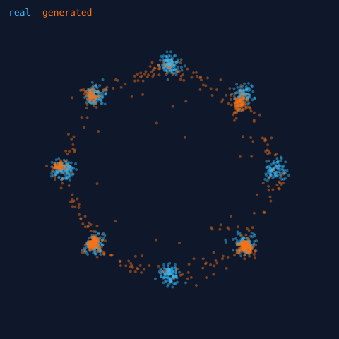
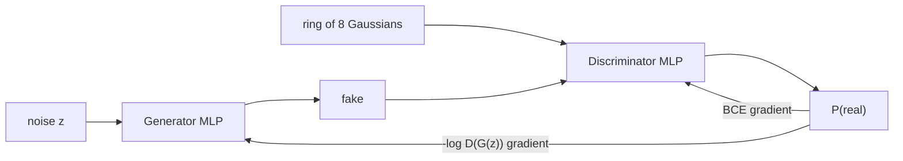

# LearnGANs - a GAN in pure NumPy

Generative Adversarial Networks demystified: a complete GAN - generator, discriminator, **hand-written
backpropagation** and Adam - in ~150 lines of NumPy. No PyTorch, no TensorFlow. It learns to generate points from a
**ring of 8 Gaussians**, the classic benchmark for *mode collapse*.



*Blue = real data, orange = generator output after 4 000 steps (seed 0).*

## Result (seed 0, 4 000 steps, ~15 s on a laptop CPU)

| step | modes covered | samples near a mode |
| ---: | :---: | ---: |
| 2 500 | 8 / 8 | 70 % |
| 3 000 | 8 / 8 | 78 % |
| 4 000 | **8 / 8** | **83 %** |

*Modes covered* = modes receiving >=1 % of generated samples within 3 sigma; *near a mode* = share of samples within
3 sigma of any mode. A vanilla GAN famously collapses onto a few modes here - the metrics make that visible.

## What is inside

| File | Purpose |
| --- | --- |
| `gan/nn.py` | MLP with explicit `forward` / `backward` and Adam. Gradients are verified against finite differences in the tests. |
| `gan/train.py` | Training loop: non-saturating generator loss, one-sided label smoothing, mode-coverage metrics, SVG plot. |
| `gan/data.py` | Ring-of-Gaussians sampler. |



## Run it

```bash
pip install numpy
python -m gan.train --steps 4000 --seed 0 --svg samples.svg
python -m unittest discover -s tests -t . -v
```

## Things to try
* Set `d_steps=5` or lower the learning rate and watch `modes_covered` drop (mode collapse / non-convergence).
* Change `n_modes`, `std` in `Config` to make the problem harder.
* Swap the loss for least-squares or hinge - the backward pass is only a few lines.
